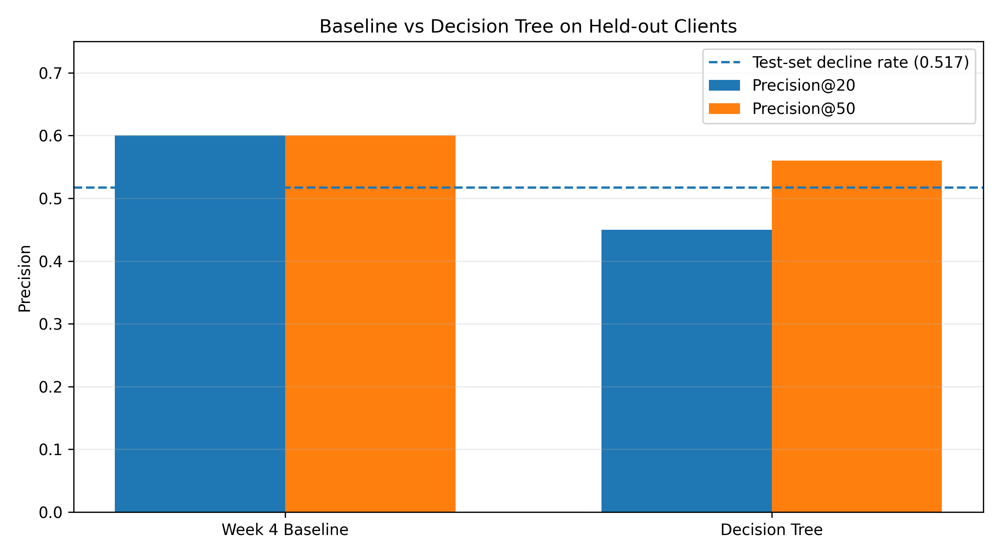
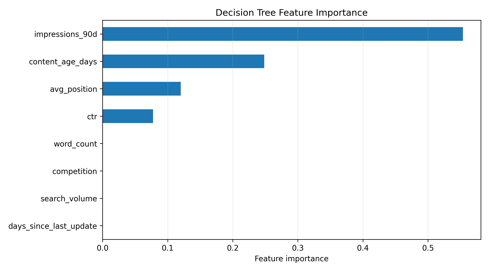
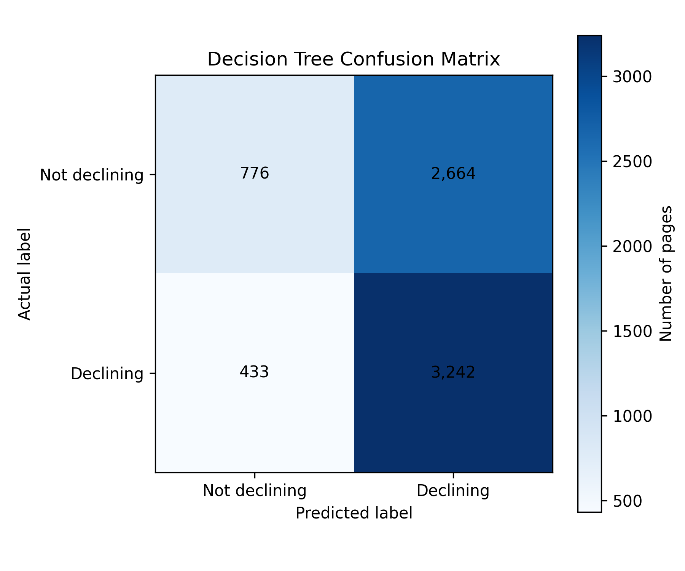

# Content Opportunity Scoring for Website Content Refresh

## A Comparative Study of Rule-Based and Machine-Learning Approaches

**Author:** Sahanashree M  
**Research Area:** Machine Learning and Search Engine Optimization (SEO)  
**Organization:** FlyRank AI Internship  
**Date:** 9 November 2026  
**Repository:** [sahanabytes/machine-learning-portfolio](https://github.com/sahanabytes/machine-learning-portfolio)

---

This study examines how rule-based scoring and machine-learning approaches can help FlyRank content teams prioritize website pages showing signs of declining search performance. When websites contain large libraries of published content, teams need a practical way to decide which pages should receive attention first for human review and potential refresh.

Using an anonymized dataset of 30,000 content records from 32 clients, this experiment compares a Week 4 rule-based baseline with a Decision Tree classifier on a client-grouped held-out test set.

The rule-based baseline achieved Precision@20 of 0.60 and Precision@50 of 0.60, outperforming the Decision Tree, which achieved 0.45 and 0.56, respectively.

The findings support retaining the transparent rule-based baseline as an initial content-prioritization method. Both approaches should support human decision-making rather than automatically trigger content changes, and observed decline should not be treated as proof that refreshing a page will improve its performance.
## 1. Research Question

FlyRank works across the content lifecycle, including researching, writing, publishing and monitoring website content. Over time, pages that once attracted search visibility can lose rankings and clicks. When a website contains thousands of pages, content teams face a practical challenge: deciding which pages deserve attention first.

This capstone examines that content-prioritization problem. A useful approach should help reviewers identify pages showing signs of decline without automatically changing or removing content.

The study compares two approaches:

- A rule-based scoring method developed as the Week 4 baseline.
- A Decision Tree classifier trained to identify records with an observed declining trend.

**Research question:** Can rule-based scoring and machine-learning models help identify website content that may be at risk of declining, so content teams can prioritize pages for human review and potential refresh?

The main decision supported by this research is which approach should be used to prioritize content for further investigation. In this experiment, the rule-based baseline performed better than the Decision Tree on both reported precision metrics.
## 2. Dataset and Features

The study uses the anonymized `content_refresh_anonymized.csv` dataset.

| Dataset characteristic | Value |
|---|---:|
| Records | 30,000 |
| Columns | 44 |
| Distinct clients | 32 |
| Training records | 22,885 |
| Test records | 7,115 |
| Training clients | 24 |
| Held-out test clients | 8 |

The dataset contains content and search-performance indicators, including:

- Impressions over 90 days
- Search volume
- Average search position
- Click-through rate (CTR)
- Content age
- Word count
- Days since the last update
- Competition

### Target definition

The target variable is `decline_label`.

- `1` represents a record whose `trend_direction` is `down`.
- `0` represents all other observed trend categories.

The target describes an observed trend. It does not indicate whether a future content refresh will succeed.

Client identifiers are used for grouping the data during splitting. Content identifiers are used for record context and error inspection, not as predictive features.

The model does not intentionally expose private client names, website URLs, page titles, or search queries.

## 3. Methodology

### 3.1 Data splitting

The dataset was divided using `GroupShuffleSplit`, with `client_id` as the grouping column.

The split used:

- Training proportion: 75%
- Test proportion: 25%
- Random state: 42

The training set contained 22,885 records from 24 clients, while the test set contained 7,115 records from 8 different clients.

There was no client overlap between the training and test sets. This design tests the approaches on clients not represented in the training set.

### 3.2 Feature selection and preprocessing

Eight features were used:

1. `days_since_last_update`
2. `impressions_90d`
3. `search_volume`
4. `competition`
5. `word_count`
6. `content_age_days`
7. `avg_position`
8. `ctr`

Trend-derived fields and the target variable were excluded from the predictive feature list to avoid target leakage.

Missing numerical values were replaced using medians calculated from the training data only. The same training medians were applied to the test data.

### 3.3 Model selection

A Decision Tree classifier was selected because it is relatively interpretable and can represent simple decision rules.

The model configuration was:

```python
DecisionTreeClassifier(
    max_depth=3,
    min_samples_leaf=100,
    random_state=42
)
```

The model was compared with the Week 4 rule-based baseline using the same held-out test records.

### 3.4 Evaluation metrics

The experiment uses Precision@20 and Precision@50.

These metrics measure the proportion of records labelled as declining among the top 20 and top 50 records ranked by each approach.

The test-set decline rate was 0.517, providing a useful reference for interpreting the ranking results.

## 4. Experimental Results

### 4.1 Baseline versus Decision Tree

| Method | Precision@20 | Precision@50 |
|---|---:|---:|
| Week 4 rule-based baseline | 0.60 | 0.60 |
| Decision Tree | 0.45 | 0.56 |

The rule-based baseline performed better than the Decision Tree at both evaluation cutoffs.

The Decision Tree's Precision@20 of 0.45 was also below the test-set decline rate of 0.517. Its Precision@50 of 0.56 was above that rate.

These results do not support replacing the existing baseline with the Decision Tree in this experiment.

### Figure 1. Ranking performance comparison



*Figure 1 compares Precision@20 and Precision@50 for both approaches. The dashed line represents the test-set decline rate.*

### 4.2 Decision Tree feature importance

The fitted Decision Tree assigned the following feature importance values:

| Feature | Importance |
|---|---:|
| Impressions over 90 days | 0.554 |
| Content age | 0.248 |
| Average position | 0.120 |
| CTR | 0.078 |
| Word count | 0.000 |
| Competition | 0.000 |
| Days since last update | 0.000 |
| Search volume | 0.000 |

Impressions over 90 days had the highest importance, followed by content age, average position, and CTR.

The remaining four features had zero importance in this fitted tree. These values describe how the fitted tree used its features; they do not establish causal relationships.

### Figure 2. Decision Tree feature importance



*Figure 2 shows the relative feature importance values from the fitted Decision Tree.*

### 4.3 Error analysis

Using the model's default classification threshold, the confusion matrix produced the following counts:

| Error category | Count |
|---|---:|
| True positives | 3,242 |
| False positives | 2,664 |
| True negatives | 776 |
| False negatives | 433 |

### Figure 3. Decision Tree confusion matrix



*Figure 3 shows the model's threshold-based classification results.*

The confusion matrix evaluates individual classifications using the default prediction threshold. It is different from Precision@20 and Precision@50, which evaluate the quality of the highest-ranked records.

The error analysis shows that the model produces both false positives and false negatives. Therefore, its predictions require further review before operational use.

## 5. Discussion

The experiment shows that a simple rule-based baseline can outperform a small Decision Tree model on the selected ranking metrics.

The baseline achieved 0.60 at both evaluation cutoffs, while the Decision Tree achieved 0.45 at Precision@20 and 0.56 at Precision@50.

One possible practical advantage of the baseline is its simplicity. Its two scoring conditions are easy for content teams to understand and apply.

The Decision Tree provides additional information about feature relationships within the fitted model. However, its feature importance values should not be interpreted as proof that changing those features will cause search performance to improve.

The results support using transparent scoring as an initial prioritization method, with machine-learning predictions serving as supplementary information.

## 6. Limitations

This experiment has several limitations:

1. **Limited client coverage:** Although the dataset contains 32 clients, only 8 clients are represented in the held-out test set.
2. **Generalization:** Results from this dataset may not generalize to other websites, industries, or content types.
3. **Observed outcome:** The target identifies an existing declining trend, not the future success of a content refresh.
4. **No causal evidence:** The experiment does not establish that refreshing content improves impressions, rankings, or traffic.
5. **Model errors:** The Decision Tree produces false positives and false negatives.
6. **Model comparison:** The Decision Tree did not outperform the rule-based baseline on either reported precision metric.
7. **Reproducibility:** Dependencies are specified using minimum supported versions rather than a fully locked software environment.

The results should therefore be treated as directional evidence from this experiment rather than a universal conclusion about content prioritization.

## 7. Recommendations

Based on the measured results, the following approach is recommended:

1. Retain the Week 4 rule-based baseline as the initial prioritization method.
2. Give 50 points to records with at least 180 days since their last update.
3. Give another 50 points to records with at least 500 impressions over 90 days.
4. Prioritize higher-scoring records for human review.
5. Use Decision Tree predictions as supplementary information rather than replacing the baseline.
6. Review the context of each selected page before making content changes.
7. Monitor performance after refreshes to collect evidence about actual outcomes.

The scoring method is intended to support editorial decisions, not automatically update or remove website content.

## 8. Reproducibility

### Main experiment

The capstone modeling experiment is documented in:

`work/notebooks/w05_model.ipynb`

The notebook contains the data checks, target definition, client-grouped split, feature selection, model training, baseline comparison, error analysis, and chart-generation code.

### Reproduction configuration

- Dataset: `data/raw/content_refresh_anonymized.csv`
- Grouping column: `client_id`
- Target: `decline_label`
- Split method: `GroupShuffleSplit`
- Test size: 0.25
- Random state: 42
- Model: `DecisionTreeClassifier(max_depth=3, min_samples_leaf=100, random_state=42)`

### Fresh repository setup

Clone the public repository:

```bash
git clone https://github.com/sahanabytes/machine-learning-portfolio.git
cd machine-learning-portfolio
```

Install the project dependencies:

```bash
pip install -r requirements.txt
```

### Running the capstone experiment

Open `work/notebooks/w05_model.ipynb` in Google Colab and run all cells from top to bottom.

The notebook setup also uses:

```python
%pip install -q duckdb huggingface_hub pandas scikit-learn matplotlib
```

Before running the experiment, ensure that the anonymized dataset is available at the documented path.

### Reference pipeline

The repository's separate reference pipeline can be run from the repository root using:

```bash
python scripts/run_all.py
```

The reference pipeline and the capstone modeling experiment are separate workflows. Their results should not be mixed.

### Reproducibility checks

A fresh execution should confirm:

- The dataset has 30,000 rows and 44 columns.
- There are 32 distinct clients.
- The training and test groups have no client overlap.
- The eight model features match the documented feature list.
- The reported metrics match a fresh notebook execution.

The experiment uses random state 42 for reproducibility. Project dependencies are listed in `requirements.txt` as minimum supported versions rather than a fully locked environment, so exact results may vary slightly across software environments.

No blind or sealed holdout evaluation is claimed in this report.

## 9. Conclusion and Future Work

This study compared a rule-based baseline with a Decision Tree classifier for identifying website content records with observed declining trends.

The rule-based baseline achieved stronger Precision@20 and Precision@50 results than the Decision Tree on the held-out clients. Based on this experiment, retaining the baseline is the more appropriate initial decision.

Future work could evaluate the approach on additional clients and time periods, investigate more robust ranking methods, and measure actual outcomes after content refreshes.

A future experiment should also examine whether the prioritization method consistently identifies pages that benefit from editorial review. Such an evaluation would help distinguish the identification of declining content from the separate question of whether refreshing that content improves performance.

## 10. Acknowledgments and Data Credit

This research was completed as part of the FlyRank AI Machine Learning Internship.

I acknowledge FlyRank for providing the learning materials, anonymized dataset, and assignment framework used in this project.

This paper presents an educational analysis based on the available data. The findings and recommendations are my own and should not be interpreted as official claims by FlyRank.

**Organization:** [FlyRank](https://flyrank.ai)

**Project repository:** [GitHub — machine-learning-portfolio](https://github.com/sahanabytes/machine-learning-portfolio)
