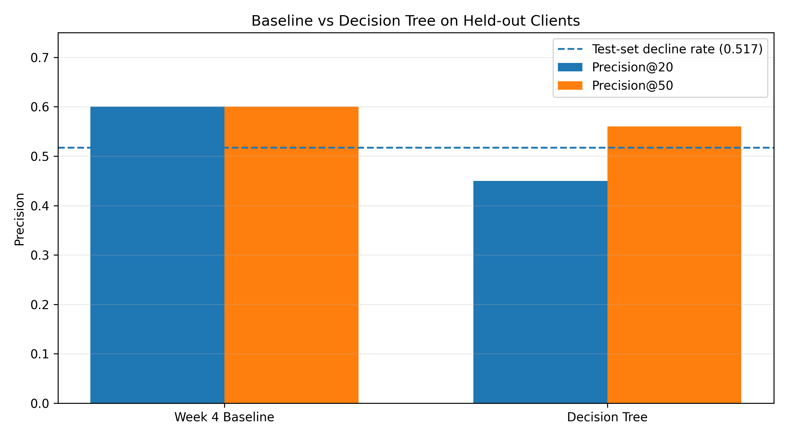
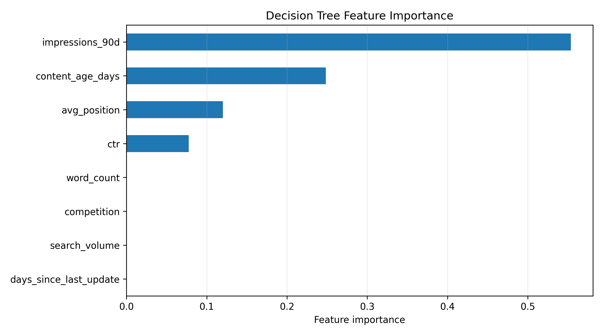
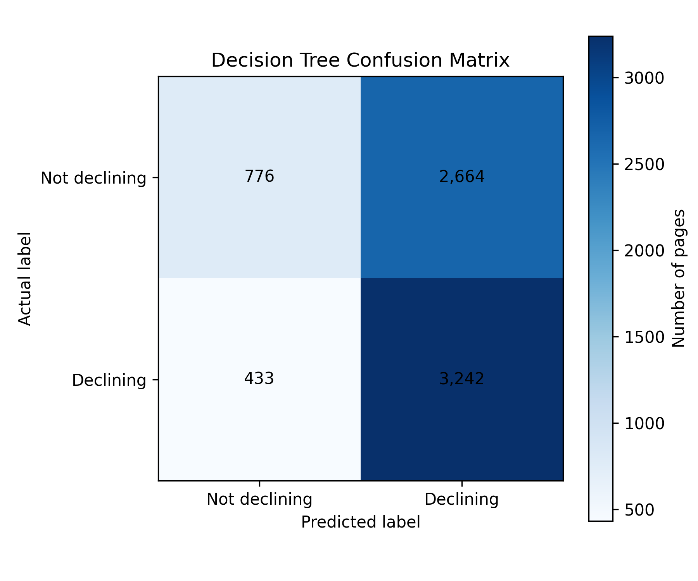

# Google Search Ranking & Discoverability Capstone

**Author:** Sahanashree M  
**Lane:** Machine Learning  
**Repository:** https://github.com/sahanabytes/machine-learning-portfolio  
**Date:** 9 November 2026

---

## 0. Abstract

This study investigates whether a simple machine learning model can help prioritize website content pages that show signs of declining search performance. It uses an anonymized dataset containing 30,000 content records and 44 columns across 32 clients. A transparent Week 4 rule-based baseline is compared with a depth-3 Decision Tree classifier using a client-grouped holdout evaluation. The baseline achieved Precision@20 of 0.60 and Precision@50 of 0.60, while the Decision Tree achieved 0.45 and 0.56, respectively. The findings support using the baseline as the stronger decision-support ranking method in this experiment, while further evaluation is needed before operational use.

## 1. Problem Framing

### Research question

Can a simple, interpretable machine learning model help identify and prioritize content pages that show signs of declining search performance?

### Decision being supported

The intended decision is which content pages an SEO editor should review first.

- **Unit of analysis:** An individual content page.
- **Output:** A ranking score indicating the likelihood of observed decline.
- **Human action:** An editor reviews high-priority pages and decides whether investigation or a content update is appropriate.
- **Cost of a wrong decision:** A healthy page may receive unnecessary attention, while a genuinely declining page may be missed.
- **Why machine learning:** A model may identify patterns across several page characteristics and help organize a large content review queue.

The model identifies observed decline patterns. It does not predict Google's ranking algorithm or establish that refreshing a page will improve its performance.

## 2. Data Safety and Leakage Prevention

### Dataset

The analysis uses the anonymized content dataset supplied for the FlyRank internship.

- **Rows:** 30,000
- **Columns:** 44
- **Clients:** 32
- **Target:** `decline_label`, defined as 1 when `trend_direction` is `down`, and 0 otherwise.

### Feature selection

The model uses these eight features:

1. `days_since_last_update`
2. `impressions_90d`
3. `search_volume`
4. `competition`
5. `word_count`
6. `content_age_days`
7. `avg_position`
8. `ctr`

### Excluded information

- `trend_direction` and `trend_pct` were excluded from model features because they directly describe the outcome used to create the target.
- Client identifiers were used only to create the grouped train/test split, never as model features.
- Content identifiers were not used as predictive features.

Missing numeric values were replaced using medians calculated from the training data only. The same training medians were applied to the test data, with zero as a final fallback.

The analysis uses anonymized records and does not intentionally expose client names, private queries, or website URLs.

## 3. Baseline

A transparent rule-based score from the Week 4 work was used as the baseline.

The score assigns:

- 50 points when `days_since_last_update` is at least 180 days.
- 50 points when `impressions_90d` is at least 500.

The maximum score is 100. Pages with higher scores are ranked first for review.

This baseline is useful because its rules are easy to understand and explain. It provides a practical comparison against the Decision Tree using the same held-out test records and ranking metrics.

## 4. Model and Analysis

### Selected method

A Decision Tree classifier was selected because it is relatively interpretable and can identify simple patterns in tabular data.

### Model configuration

- Algorithm: `DecisionTreeClassifier`
- Maximum depth: 3
- Minimum samples per leaf: 100
- Random state: 42

The model was trained to identify the observed decline label. Its predicted probability for the positive class was used as the ranking score.

### Target definition

`decline_label = 1` when `trend_direction` equals `down`; otherwise, it equals 0.

This is an observed historical label, not a measure of successful content refresh.

## 5. Evaluation

### Split design

A grouped split was created using `GroupShuffleSplit`.

- Random state: 42
- Test size: 25%
- Training rows: 22,885
- Testing rows: 7,115
- Training clients: 24
- Testing clients: 8
- Client overlap: None

The grouped split keeps each client's records in only one partition, reducing the risk of evaluating the model on clients it has already seen.

The decline rate was 0.550 in training and 0.517 in testing. Therefore, the test-set positive-class base rate was approximately 51.7%.

### Model versus baseline

Both methods were evaluated on the same held-out test records.

| Method | Precision@20 | Precision@50 |
|---|---:|---:|
| Week 4 baseline | 0.60 | 0.60 |
| Decision Tree | 0.45 | 0.56 |
| Test-set decline rate | 0.517 | 0.517 |

The Week 4 baseline performed better at both ranking cutoffs. The Decision Tree did not outperform the existing rule-based approach in this experiment.

### Figure 1. Baseline versus Decision Tree Performance



The dashed line represents the test-set decline rate of 0.517. The baseline achieved higher precision than the Decision Tree at both cutoffs.

## 6. Interpretation and Error Analysis

### Feature importance

The fitted Decision Tree relied most on:

| Feature | Importance |
|---|---:|
| impressions_90d | 0.554 |
| content_age_days | 0.248 |
| avg_position | 0.120 |
| ctr | 0.078 |
| word_count | 0.000 |
| competition | 0.000 |
| days_since_last_update | 0.000 |
| search_volume | 0.000 |

### Figure 2. Decision Tree Feature Importance



Impressions over the previous 90 days contributed the largest share of the tree's feature importance, followed by content age. Four listed features had zero importance in this fitted tree. These values describe this particular model and should not be interpreted as causal effects.

### Error analysis

Using the classifier's default prediction threshold, the test-set confusion matrix contained:

- True positives: 3,242
- False positives: 2,664
- True negatives: 776
- False negatives: 433

### Figure 3. Decision Tree Confusion Matrix



The model produced many false positives, meaning it classified some pages as declining when their observed label was not declining. It also missed some pages with an observed decline label.

The confusion matrix uses threshold-based classification, while Precision@20 and Precision@50 evaluate the ranked review queue. These are different evaluation views and should not be treated as interchangeable.

### Main finding

The transparent Week 4 baseline performed better than the Decision Tree on this held-out client group. The tree identified useful patterns in impressions, content age, average position, and CTR, but these patterns did not translate into better ranking precision in this experiment.

The results are directional because the test set contains eight held-out clients. They do not establish that refreshing a page causes improved search performance.

## 7. Recommendations

### Recommended approach

Retain the Week 4 rule-based baseline as the stronger initial ranking method based on the current experiment.

### Suggested workflow

1. Use the baseline score to create an initial content review queue.
2. Ask an SEO editor to review high-priority pages.
3. Investigate possible reasons for declining impressions and performance.
4. Decide whether a content update is appropriate based on additional evidence.
5. Monitor subsequent performance rather than assuming an update will produce improvement.

### Confidence and limitations

The recommendation has moderate practical confidence for this dataset, but it is not a universal conclusion.

Important limitations include:

- Only 32 clients are represented.
- The held-out test group contains eight clients.
- The target identifies observed decline, not the success of a content refresh.
- The Decision Tree did not outperform the baseline.
- The results do not establish causal relationships.
- Further validation across additional clients and time periods is needed.

## 8. Reproducibility

### Main experiment

The capstone modeling experiment is documented in:

`work/notebooks/w05_model.ipynb`

The notebook contains the data checks, target definition, client-grouped split, feature selection, model training, baseline comparison, error analysis, and chart-generation code.

### Reproduction configuration

- Dataset: `data/raw/content_refresh_anonymized.csv`
- Grouping column: `client_id`
- Target: `decline_label`
- Split method: `GroupShuffleSplit`
- Test size: 0.25
- Random state: 42
- Model: `DecisionTreeClassifier(max_depth=3, min_samples_leaf=100, random_state=42)`

### Environment setup

From the repository root, install the project dependencies:

```bash
pip install -r requirements.txt
```

For the capstone notebook in Google Colab, the notebook setup also uses:

```python
%pip install -q duckdb huggingface_hub pandas scikit-learn matplotlib
```

### Reference pipeline

The repository's separate reference pipeline can be run from the repository root using:

```bash
python scripts/run_all.py
```

The reference pipeline and the capstone modeling experiment are separate workflows. Their results should not be mixed.

### Reproducibility checks

A fresh execution should confirm:

- The dataset has 30,000 rows and 44 columns.
- There are 32 distinct clients.
- The training and test groups have no client overlap.
- The eight model features match the documented feature list.
- The reported metrics match a fresh notebook execution.

The experiment uses random state 42 for reproducibility. Exact package versions should be recorded when the final environment is verified.

No blind or sealed holdout evaluation is claimed in this report.

## 9. Acknowledgments and Data Credit

This project was completed as part of the FlyRank Machine Learning Internship.

The analysis uses the anonymized dataset and learning resources supplied for the internship.

**Built on the [FlyRank ML Internship dataset](https://flyrank.ai).**
